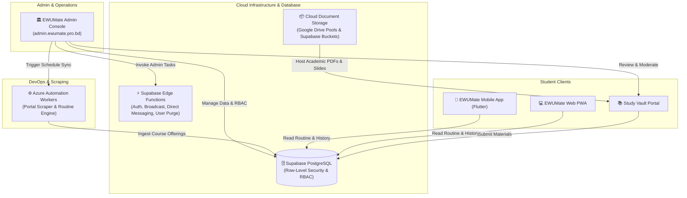

# 🏛️ EWUMate Admin Console (Mission Control)

[](https://github.com/rxxeron/ewumate-admin-panel/actions/workflows/deploy-admin.yml)
[](https://admin.ewumate.pro.bd)
[](#tech-stack)
[](#security-architecture)

The **EWUMate Admin Console** is the centralized mission control and administrative backbone for the **EWUMate Ecosystem** at East West University. It governs academic catalogs, automated portal scrapers, push notification broadcasts, student moderation queues, crowdsourced study materials, and real-time cloud infrastructure telemetry.

---

## 🌐 The EWUMate Ecosystem

The Admin Console operates as the orchestration layer connecting student-facing clients, cloud databases, and automation workers:



---

## ⚡ Core Features & Functional Domains

The Admin Console is structured into **four distinct operational domains**:

### 1. 📊 Overview & Insights
* **Platform Overview ([`Dashboard.tsx`](src/pages/Dashboard.tsx))**: Real-time KPI statistics (Total Students, 24h Active Users, Live Programs, Course Sections), dynamic growth sparklines, and active semester track switches.
* **Analytics Studio ([`Analytics.tsx`](src/pages/Analytics.tsx))**: Rolling MAU/YAU trends, retention heatmaps, onboarding conversion funnels, and peak hourly engagement telemetry.
* **System Diagnostics ([`SystemDiagnostics.tsx`](src/components/dashboard/SystemDiagnostics.tsx))**: Live latency probing against Supabase DB edge nodes, Azure worker health checks, and broadcaster availability.

### 2. 🎓 Academic Core
* **Active Semester Management ([`ActiveSemester.tsx`](src/pages/ActiveSemester.tsx))**: Control current and upcoming semester terms, toggle advising access flags, and configure multi-track programs (Tri-Semester, Bi-Semester Pharmacy, Bi-Semester Law).
* **Course Catalog ([`CoursesList.tsx`](src/pages/CoursesList.tsx))**: Fast search, filtering, and pagination over active semester course schedules and section routines.
* **Academic Calendar Editor ([`CalendarEditor.tsx`](src/pages/CalendarEditor.tsx))**: Visual management of university deadlines, payment dates, advising slots, and holiday schedules.
* **Global Master Data ([`AcademicData.tsx`](src/pages/AcademicData.tsx))**: Manage degree requirements, department mappings, and minimum credit policies.
* **Faculty Hub**:
  * **Faculty Directory ([`FacultyMaster.tsx`](src/pages/FacultyMaster.tsx))**: Centralized faculty list with initials, designations, and departmental alignments.
  * **Office Hours ([`OfficeHoursModeration.tsx`](src/pages/OfficeHoursModeration.tsx))**: Verify and approve student-submitted faculty office schedules.
  * **Faculty Proofs ([`FacultyAssignmentsModeration.tsx`](src/pages/FacultyAssignmentsModeration.tsx))**: Moderate course-instructor assignment proofs.
  * **Student Reviews ([`FacultyReviewsModeration.tsx`](src/pages/FacultyReviewsModeration.tsx))**: Multi-criteria review moderation queue (clarity, exam alignment, fairness).

### 3. 👥 Community & Moderation
* **Student Directory ([`UsersList.tsx`](src/pages/UsersList.tsx))**: Database-filtered student registry with cascading department/program dropdowns, onboarding state filters, and CSV export.
* **Student Detail Inspector ([`UserDetails.tsx`](src/pages/UserDetails.tsx))**: Inspect individual student records, enrolled courses, completed course history with grade audit, local reminders, and FCM device tokens.
* **Study Vault Moderation ([`StudyVaultManager.tsx`](src/pages/StudyVaultManager.tsx))**: Document review queue for student-uploaded past exam papers, lecture slides, and lab manuals with Google Drive multi-pool tracking.
* **Feedback Inbox ([`Feedbacks.tsx`](src/pages/Feedbacks.tsx))**: Bug reports, feature suggestions, and student support triage.
* **Developer Support ([`Donations.tsx`](src/pages/Donations.tsx))**: Track community contributions, bKash/Nagad verification, and donor recognitions.

### 4. 🛠️ Automation & DevOps
* **Portal Automation Scraper ([`PortalAutomation.tsx`](src/pages/PortalAutomation.tsx))**: Trigger automated headless portal scraping sessions, inspect diffs, and push updated schedules directly to the live course tables.
* **Cloud Push Broadcaster ([`Notifications.tsx`](src/pages/Notifications.tsx))**: Multi-targeted push notifications via Firebase Cloud Messaging (FCM) targeted by department, student ID, app version, or global broadcast with lockscreen preview.
* **Local Alarms & Logs**: Audit client device notification schedules and delivery telemetry.
* **File Sync & Parser ([`FileParser.tsx`](src/pages/FileParser.tsx))**: Parse university PDFs (advising routine, exam schedules) and synchronize into storage.
* **Data Integrity Audits ([`DataQuality.tsx`](src/pages/DataQuality.tsx))**: Automated anomaly detection scanning for duplicate sections, orphan courses, or invalid degree requirements.
* **App Config & Ad Settings ([`Settings.tsx`](src/pages/Settings.tsx))**: Configure mandatory app version updates, dynamic banner announcements, and monetization placements.

---

## 🔒 Security Architecture

The Admin Console adheres to a **Zero-Trust Client** security model:

1. **No Client-Side Service Role Key**:
   * The client bundle **never** includes or exposes `SUPABASE_SERVICE_ROLE_KEY`.
   * Standard browser operations run via the authenticated client with the admin's verified JWT.
2. **Server-Enforced Row-Level Security (RLS)**:
   * Database access is guarded by PostgreSQL functions (`public.is_admin()`), verifying that `auth.uid()` exists in `public.admin_users`.
   * Unauthenticated or non-admin users cannot read or write data, even if they extract the public `anon` key.
3. **Hardened AuthGuard ([`AuthGuard.tsx`](src/components/AuthGuard.tsx))**:
   * Network-validates active sessions using `supabase.auth.getUser()`.
   * Gracefully hydrates state without premature redirects during page refreshes.
   * Instantly terminates revoked sessions and logs audit records.
4. **Server-Side Edge Functions for Superadmin Tasks**:
   * Operations requiring root database privileges (e.g., hard-purging accounts from `auth.users` or dispatching FCM messages) are delegated to Supabase Edge Functions with Bearer token authentication.

---

## 🎨 UI/UX & Design System

* **Adaptive Layout ([`Layout.tsx`](src/components/Layout.tsx))**:
  * Persistent 4-zone grouped sidebar with live notification badges.
  * **Collapsible Mini-Sidebar Mode** (icon-only mode persisted in `localStorage`) for high-density data tables.
  * Top utility header with dynamic breadcrumbs, live database edge ping indicator, and quick actions.
* **Universal Spotlight Command Palette ([`CommandPalette.tsx`](src/components/CommandPalette.tsx))**:
  * Press **`⌘K`** or **`Ctrl + K`** from anywhere to trigger instant search across all 22 administrative views and live student records.
* **Dynamic Database Dropdowns ([`DatabaseDropdowns.tsx`](src/components/ui/DatabaseDropdowns.tsx))**:
  * Dropdown components (`<DepartmentSelect />`, `<ProgramSelect />`, `<SemesterSelect />`, `<StatusSelect />`) query dynamic database entities from `programs`, `semesters`, and `faculty_master` with in-memory deduplication.
* **Fluid Theming**: Built-in dark and light modes with semantic contrast tokens and smooth transitions.

---

## 🚀 Performance & Bundle Optimization

* **Route-Level Code Splitting ([`App.tsx`](src/App.tsx))**:
  * All 22 views are lazily loaded with `React.lazy()` and wrapped in unified `<PageSkeleton />` fallbacks.
  * Main JavaScript bundle reduced from **1,960 KB to ~317 KB** (over **83% initial payload reduction**).
  * Heavy dependencies like `jspdf`, `html2canvas`, and charting libraries only load when their respective modules are accessed.

---

## 🛠️ Tech Stack

| Layer | Technologies |
| :--- | :--- |
| **Framework** | [React 19](https://react.dev/), [TypeScript 5.9](https://www.typescriptlang.org/) |
| **Bundler & Tooling** | [Vite 8](https://vite.dev/), [PostCSS](https://postcss.org/), [ESLint 9](https://eslint.org/) |
| **Styling & Icons** | [Tailwind CSS v4](https://tailwindcss.com/), [Lucide React](https://lucide.dev/) |
| **Component Primitives** | [Radix UI](https://www.radix-ui.com/), Class Variance Authority (`cva`) |
| **Routing** | [React Router v7](https://reactrouter.com/) |
| **Data & State** | [Supabase JS Client v2](https://supabase.com/docs/reference/javascript), Realtime Channels |
| **Visualizations** | [Recharts 3.8](https://recharts.org/), [Framer Motion 12](https://www.framer.com/motion/) |
| **Reporting & Export** | [jsPDF](https://github.com/parallax/jsPDF), [jsPDF-AutoTable](https://github.com/simonbengtsson/jsPDF-AutoTable) |
| **CI/CD** | [GitHub Actions](https://github.com/features/actions), [GitHub Pages](https://pages.github.com/) |

---

## 💻 Local Development Setup

### 1. Prerequisites
* **Node.js**: `v20.x` or `v22.x` LTS
* **npm**: `v10.x+`

### 2. Installation
```bash
# Clone the repository
git clone https://github.com/rxxeron/ewumate-admin-panel.git
cd ewumate-admin-panel

# Install dependencies
npm install
```

### 3. Environment Variables
Duplicate `.env.example` to `.env`:
```bash
cp .env.example .env
```

Fill in your configuration:
```ini
# Supabase Project Configuration
VITE_SUPABASE_URL=https://your-project.supabase.co
VITE_SUPABASE_ANON_KEY=eyJhbGciOiJIUzI1NiIsInR5cCI6IkpXVCJ9...

# Backend Scraper Microservices Host
VITE_AZURE_FUNCTION_URL=https://your-azure-functions.azurewebsites.net
```

### 4. Run Development Server
```bash
npm run dev
```
Open [http://localhost:5173](http://localhost:5173) in your browser.

### 5. Build & Typecheck
```bash
npm run build
```

---

## 🚢 Deployment (GitHub Pages & Custom Domain)

The repository features an automated GitHub Actions deployment pipeline ([`deploy-admin.yml`](.github/workflows/deploy-admin.yml)) targeting **`admin.ewumate.pro.bd`**.

### GitHub Repository Secrets Required
Set these secrets under **Settings → Secrets and variables → Actions**:

* `VITE_SUPABASE_URL`: Public Supabase Project URL.
* `VITE_SUPABASE_ANON_KEY`: Public Supabase Anon API Key.
* `VITE_AZURE_FUNCTION_URL`: Azure automation endpoints URL.

### GitHub Pages Settings
1. Go to **Settings → Pages**.
2. Under **Build and deployment > Source**, choose **GitHub Actions**.
3. Under **Custom domain**, ensure `admin.ewumate.pro.bd` is configured with **Enforce HTTPS** enabled.

---

## 📄 License & Maintainers

Maintained by the **EWUMate Engineering Team**. Distributed for internal East West University administrative and academic operational management.
